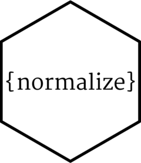

<!-- README.md is generated from README.Rmd. Please edit that file -->

```{r, setup, include = FALSE}
knitr::opts_chunk$set(collapse = TRUE, comment = "#>")
library("normalize")
```

# Normalization of Numeric Data 

<!-- badges: start -->
[](https://github.com/loelschlaeger/normalize/actions/workflows/R-CMD-check.yaml)
[](https://CRAN.R-project.org/package=normalize)
[](https://CRAN.R-project.org/package=normalize)
[](https://app.codecov.io/gh/loelschlaeger/normalize?branch=master)
<!-- badges: end -->

The `{normalize}` `R` package offers convenient tools to normalize numeric data
from common R objects (i.e., to subtract the mean and to divide by the standard
deviation):

1. works for `vector`, `matrix`, `data.frame`, `ts`, and `list` objects

2. can normalize by row or by column

3. can ignore rows or columns when normalizing

4. allows for joint normalizing of rows or columns

5. provides the normalizing constants as attributes

6. preserves object attributes

## Installation

You can install the released version from [CRAN](https://CRAN.R-project.org) with:

```{r, install released, eval = FALSE}
install.packages("normalize")
```

## Examples

Normalize a `vector` by centering, scaling, or both. The centering and scaling
values used are stored in the `"center"` and `"scale"` attributes.

```{r, vector example}
x <- 1:10
normalize(x)
normalize(x, center = FALSE)
normalize(x, scale = FALSE)
```

Normalize a `matrix` column-wise, optionally with joint normalization of
columns, which then share one centering and one scaling value:

```{r, matrix example}
normalize(
  matrix(1:12, nrow = 3, ncol = 4),
  jointly = list(1:2, 3:4) # joint normalization of columns 1, 2 and 3, 4
)
```

Normalize a `data.frame` while keeping non-numeric columns unchanged:

```{r, data.frame example}
normalize(
  data.frame(a = 1:3, b = c("A", "B", "C"), c = 7:9, d = 10:12),
  ignore = 2 # ignore character column 2 for normalization
)
```

Normalize a time series (class `ts`) while keeping its time series properties:

```{r, ts example}
normalize(ts(c(1, 3, 5, 7), start = c(2000, 1), frequency = 4))
```

Can work on a `list`:

```{r, list example}
normalize(list(1:5, diag(3), data.frame(a = 1:3, b = 2:4)))
```
